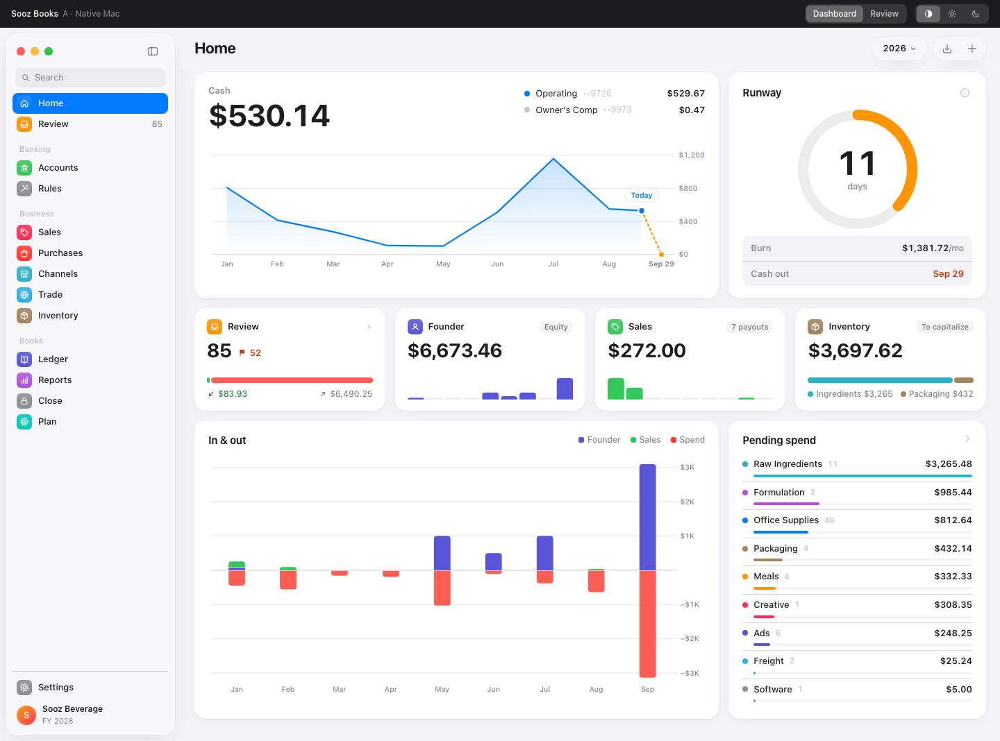

# Sooz Books

Double-entry accounting software for [Sooz](https://drinksooz.com), a CPG beverage brand with a
co-manufactured product. It is the system of record for the company's books — it replaces
QuickBooks rather than sitting on top of it.

Generic accounting software misses what a CPG brand actually needs to see: payouts booked net of
marketplace fees, distributor deductions that quietly eat margin, trade spend, landed cost from a
co-manufacturer, and margin by channel. This tracks all of it, across the five ways Sooz sells:
DTC (Shopify), Amazon, retail through distributors, wholesale/Faire, and restaurants.



## What it does

**Banking.** Drag in a CSV or Excel export from any bank or card. The importer learns each bank's
column layout once and remembers it. Re-importing the same file, or an overlapping date range,
adds nothing twice — every row carries a fingerprint. A review queue categorizes each transaction
by rule first, then asks a model for a suggestion on whatever is left. Nothing reaches the ledger
without a human approving it. Reconcile against a statement balance when the month closes.

**Receipts.** Some spending never shows up on a Relay statement: a member paid on a personal card. Open
the **Assistant**, drop in a photo or PDF of the receipt, and it reads the vendor, date and total,
proposes the entry (expense or inventory debited, that member's own contributions account credited),
and waits. You check it and tap **Post**. A typed message ("the sugar is ingredients", "Mo paid")
corrects a card. Nothing posts until you tap, and the model cannot post at all.

**Sales and purchases.** Customers, invoices, receipts applied across invoices, and AR aging.
Vendors, bills, payments, and AP aging, with 1099-NEC totals at year end.

**Channels.** Shopify, Amazon and Faire settlements post their full gross detail — sales,
discounts, refunds, fees, ads, tax collected — against a per-channel clearing account, which the
bank deposit then clears to zero. Sales tax is tracked by state, with marketplace-facilitator tax
kept out of the liability.

**Trade spend.** A promotion calendar, distributor remittance import that splits a short-pay into
a payment plus its deductions, and a workbench for validating, disputing, recovering or writing
off each deduction.

**Inventory and COGS.** Peasy stays the operational system of record for quantities; the books
carry values. Ingredients, packaging, co-man tolling and freight-in capitalize into inventory,
land as a per-unit cost on each production run, and release to COGS as units ship.

**Reports and planning.** P&L (by month, by channel), balance sheet, trial balance, general
ledger, cash flow, margin, budget vs actual, and a 13-week cash forecast. Accrual books with a
cash-basis toggle.

**Close.** A month-end checklist, period locking, and an append-only audit log of who changed
what, when.

## Rules the code obeys

These are not style preferences. Breaking one corrupts the books.

1. **Money is integer cents** in `bigint` columns. No floating point anywhere in the money path.
2. **`postJournalEntry()` is the only code that writes `journal_lines`.** Every module posts
   through it.
3. **Posting order is draft → lines → post, in one transaction.** A posted entry is immutable;
   corrections are reversals.
4. **Every write transaction sets its actor** (`withActor()`), or the audit trail records nobody.
5. **Revenue is never booked net.**
6. **Dates are `YYYY-MM-DD` strings**, never `Date` objects.
7. **Nothing posts from an import without human approval**, except through a rule the owner
   explicitly marked `auto_post`.

The database enforces the ones it can. Triggers reject an entry that does not balance or has
fewer than two lines, refuse any change to a posted entry, refuse to post into a closed period,
lock a reconciled bank transaction, and write every financial change to an audit log owned by a
role that cannot delete from it. `CLAUDE.md` has the full set.

## Stack

Next.js 16 (App Router) · TypeScript · Tailwind v4 · Drizzle ORM over postgres.js ·
Supabase (Postgres, Auth, Storage) · Vitest · Playwright · deployed on Vercel.

Drizzle is used for typed queries only. Migrations are hand-written SQL in `supabase/migrations/`,
applied in order.

## Getting started

```bash
npm install
cp .env.example .env.local   # then fill in the database password
npm run dev
```

`.env.local` needs:

| Variable | What it is |
| --- | --- |
| `DATABASE_URL` | Session-mode pooler URL for the `sooz_app` role. Session mode, not transaction mode — the ledger needs multi-statement transactions. |
| `NEXT_PUBLIC_SUPABASE_URL` | The Supabase project URL. |
| `NEXT_PUBLIC_SUPABASE_ANON_KEY` | The publishable key. Safe in the browser. |
| `SUPABASE_SERVICE_ROLE_KEY` | Server-only. Needed for invitation links (creating an invited account) and for storing and opening receipts. Never expose it. |
| `ANTHROPIC_API_KEY` or `AI_GATEWAY_API_KEY` | Optional. Without one, the review queue falls back to rules alone. |
| `AI_RECEIPT_MODEL` | Optional. The model that reads receipts. Defaults to `anthropic/claude-sonnet-5`. It must accept a forced tool call and no sampling parameters: `claude-sonnet-5` (default) and `claude-haiku-4-5` do. Newer models (Sonnet 5.5, Opus 5.5, Fable 5.1) reject the forced tool call this adapter sends, so do not point it at them until the adapter supports `auto` plus strict tools. |

Applying a migration:

```bash
psql "$DATABASE_URL" -f supabase/migrations/0044_invite_tokens.sql
```

## Tests

```bash
npm test          # unit — posting engine, parsers, reports, importers
npm run lint
npm run typecheck
npx playwright test   # end-to-end flows against a local database
```

The unit suite starts its own throwaway Postgres on port 54330 and rebuilds it from
`supabase/migrations/`, so no test can touch the real books. That needs `initdb` and `pg_ctl` on
your `PATH` (`brew install postgresql@17`). The end-to-end suite does the same on port 54329 and
signs in through real Supabase auth.
The Assistant's flow runs with `RECEIPT_FIXTURES=1`, which swaps in a fixed receipt reader and an in-memory file store; it is honoured only outside production and outside Vercel.

Tests never call a model. The AI keys are blanked for the suite unless `RUN_AI_INTEGRATION=1`.

## Layout

```
src/app/(app)/       the authenticated application
src/app/(auth)/      sign-in and invitations
src/db/schema/       Drizzle tables mirroring the live schema
src/lib/ledger/      posting engine, reversals, periods, balances, chart of accounts
src/lib/banking/     parsing, import profiles, fingerprints, rules, AI suggestions, reconciliation
src/lib/importers/   shopify, amazon, faire, distributor remittances, peasy, quickbooks
src/lib/reports/     trial balance, P&L, balance sheet, cash flow, aging, margin, forecast
src/lib/auth/        roles, capabilities, invitations
supabase/migrations/ hand-written SQL, applied in order
docs/formats/        what each bank and channel export actually looks like
docs/design/         the Native Mac design system and reference mockup
scripts/             one-off intake, verification and screenshot tooling
```

## Access

The books are invite-only, enforced in the database rather than the app. The owner is whoever
matches `app_settings.owner_email`; everyone else needs a single-use invitation link, whose token
is stored only as a hash and expires in seven days. Calling Supabase's public sign-up endpoint
directly gets nobody in.

## Deploying

```bash
./scripts/deploy-vercel.sh
```

Environment variables live in the Vercel project, not in the repo.

## Never commit

`.env.local` and anything under `data/` — real bank statements and exports live there. Both are
gitignored. If a credential ever does land in a commit, rotate it rather than only deleting it;
the history keeps what the working tree drops.
